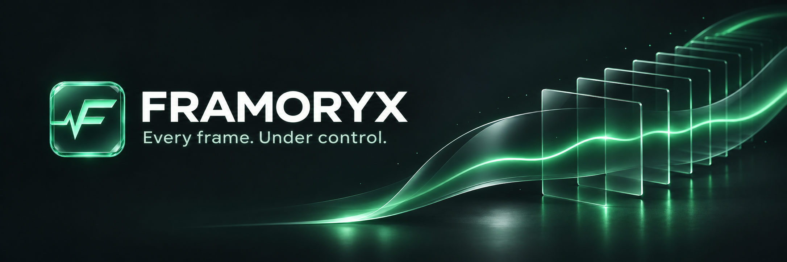
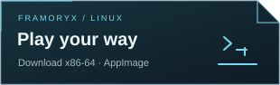
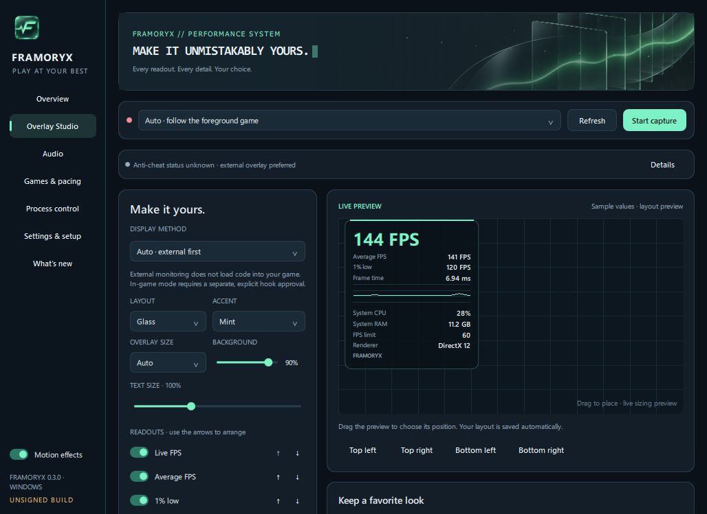
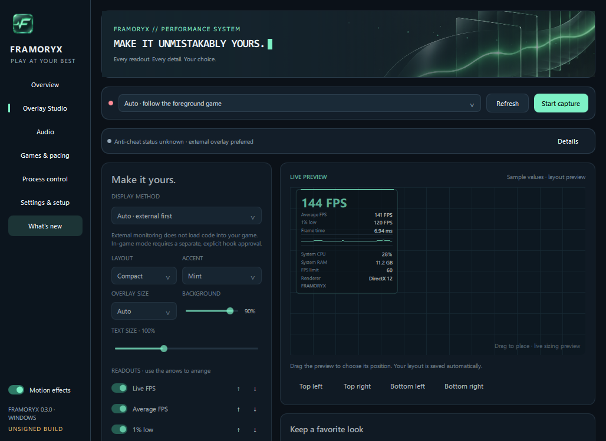
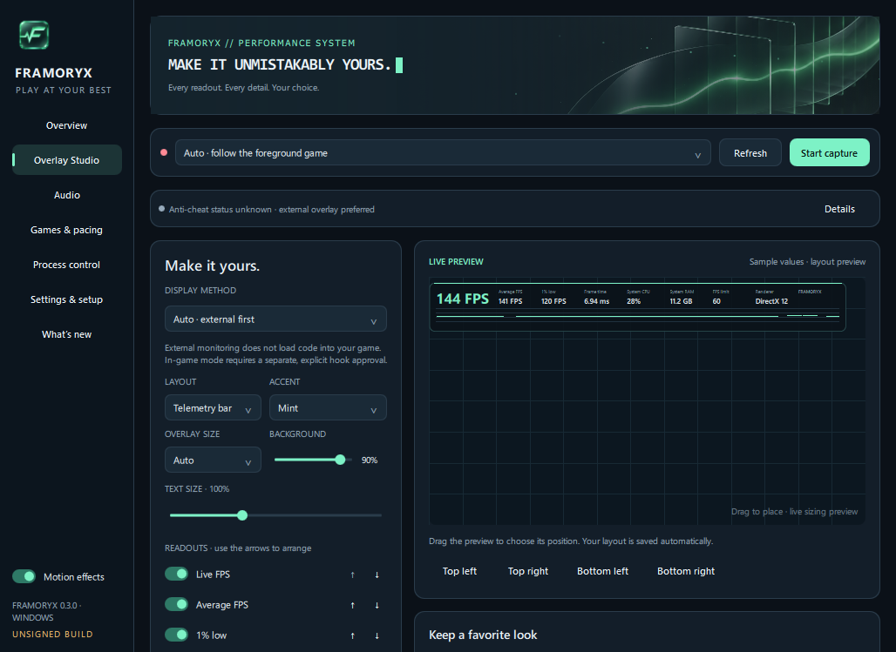
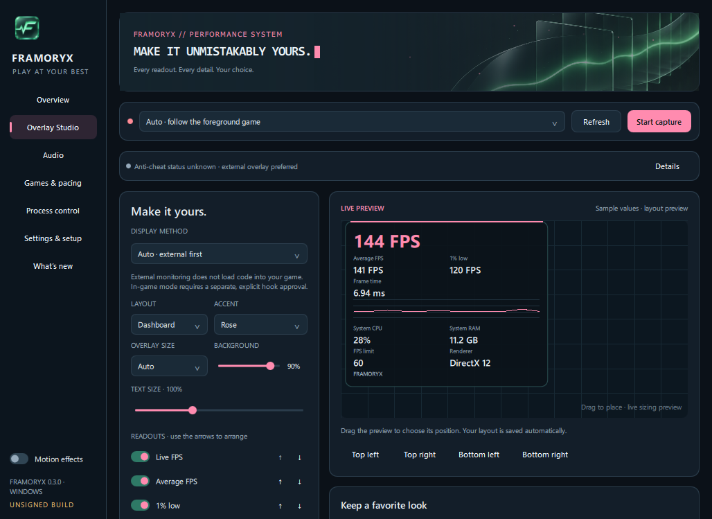
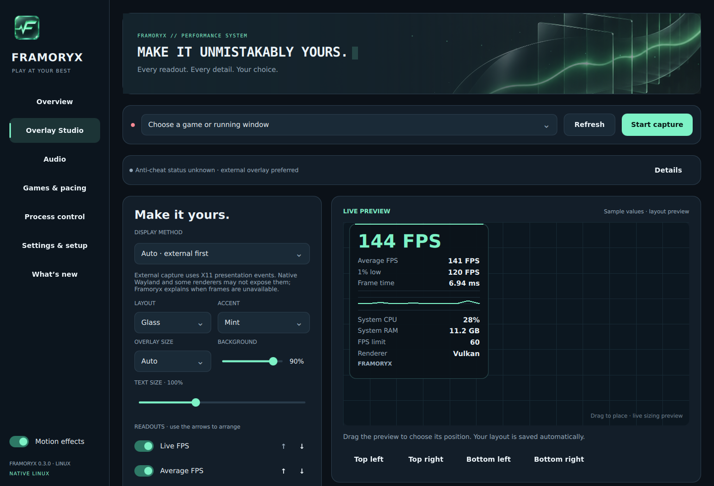
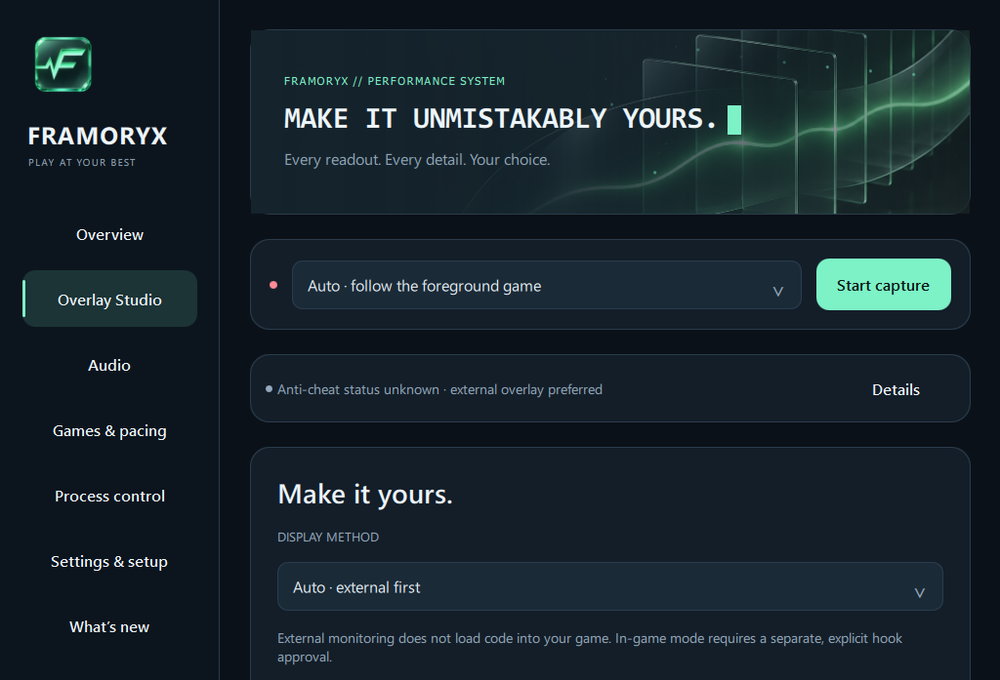
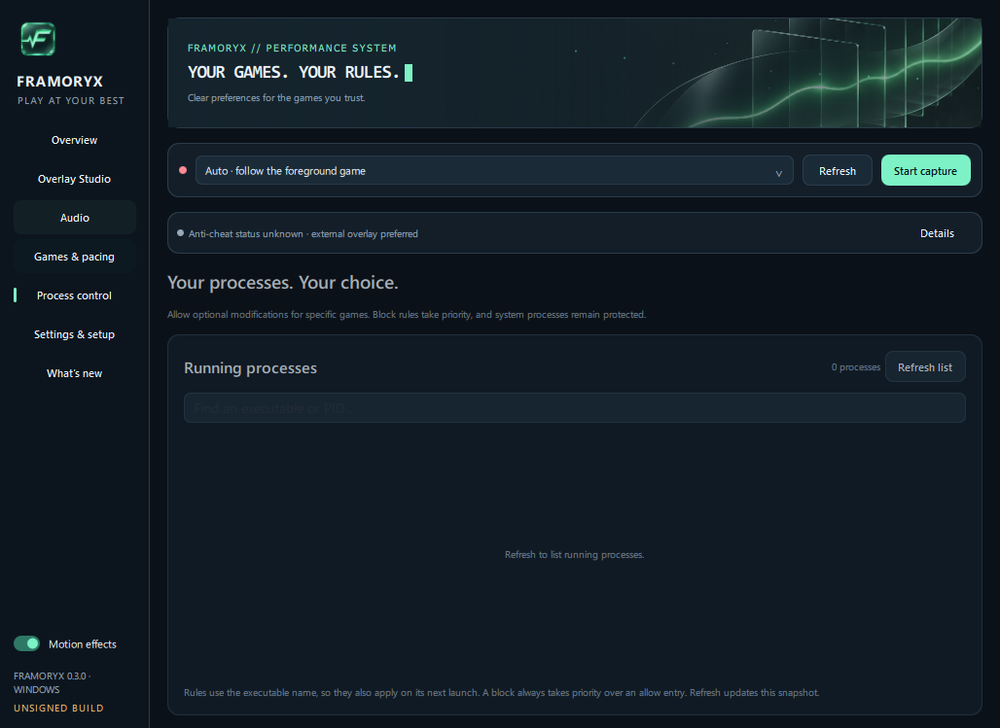
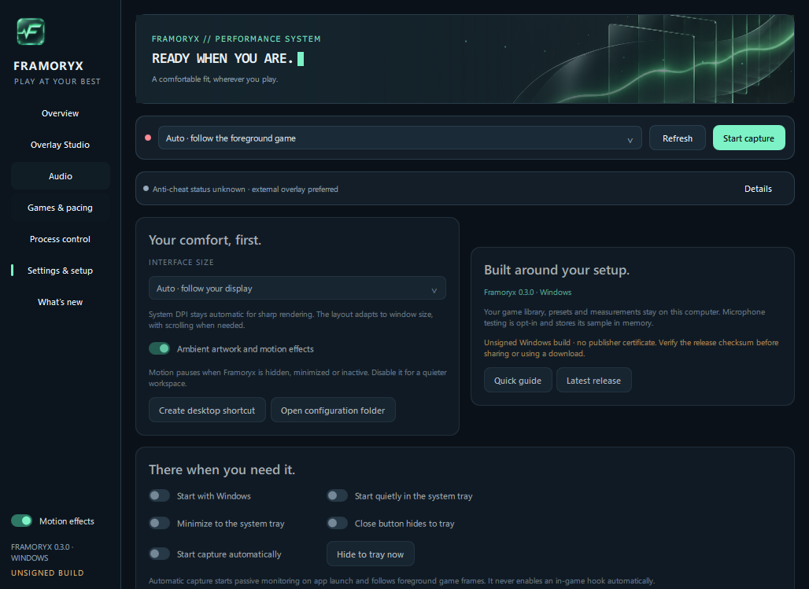

<div align="center">
  
  <p>A native Windows and Linux toolkit for performance overlays, frame pacing, borderless play and audio control.</p>
  <a href="https://github.com/NeTriXoN-BoT/framoryx/releases/latest/download/Framoryx-Windows-x64.zip"></a>
  &nbsp;
  <a href="https://github.com/NeTriXoN-BoT/framoryx/releases/latest/download/Framoryx-Linux-x86_64.AppImage"></a>
  <p><a href="https://github.com/NeTriXoN-BoT/framoryx/releases/latest">Release notes &amp; checksums</a> · <a href="https://github.com/NeTriXoN-BoT/framoryx/releases/latest/download/Framoryx-Linux-x86_64.tar.gz">Portable Linux archive</a> · <a href="https://github.com/NeTriXoN-BoT/framoryx/releases/latest/download/Framoryx-Source.zip">Source</a></p>
  <p><sub><strong>UNSIGNED WINDOWS BUILD</strong> · No Authenticode publisher certificate.<br>Windows may display an unknown-publisher or SmartScreen warning. Verify the release SHA-256 before use.</sub></p>
</div>

## Your game. Your overlay.

Measure real frame data, choose the information that matters, and make the HUD fit your setup. Framoryx uses a shared C++ and Qt interface with native monitoring and audio integrations for each platform. Default capture loads no code into your game; game layers and hooks are a separate, explicit choice.

| Measure | Make it yours | Take control |
| --- | --- | --- |
| Live FPS, average FPS, 1% lows, frame times and a rolling graph | Five HUD layouts and sixteen independent readouts | Optional frame limiting and reversible borderless play |
| CPU, GPU, RAM and VRAM usage, with available temperatures, clocks and power | Ten accents, transparent backgrounds, font sizing and draggable positioning | Searchable process rules, per-game settings and a game library |
| Local capture history and CSV export | Automatic display/DPI sizing and percentage overrides for app and HUD | Output up to 200%, compensated bass, microphone EQ and verified RNNoise |
| Missing hardware readings stay unavailable | Named presets, ordering and preset import/export | Tray access, sign-in launch, quiet startup and optional auto capture |



<details>
<summary>More layouts, the Linux desktop and maximized scaling</summary>

**Compact** keeps the selected information in a smaller footprint.



**Telemetry Bar** spreads the readouts horizontally.



**Dashboard** gives metrics more room. **Minimal** removes extra decoration.



The Linux application uses the same interface and artwork, with native Linux controls.



Automatic DPI rendering and percentage controls keep the design aligned when maximized.



</details>

<details>
<summary>Game controls and process rules</summary>





</details>

## Get started

1. Download the complete package. On Windows, extract the ZIP and open **Framoryx.exe**. On Linux, make the AppImage executable and open it, or extract the portable archive and run **AppRun**.
2. Open your game, choose its running window or library entry, and select **Start capture**. On Windows, **Auto** follows the foreground game. On Linux, Auto follows allowed X11 games.
3. Select **Show overlay**. Open **Overlay Studio** to choose readouts, layout, size, colors and position.
4. Use **Games & pacing** for supported frame limits, borderless play and explicit library launches. Starting capture does not launch a second copy of your game.

**Interface size → Auto** adapts to your display, DPI and available work area. Manual percentages remain available. Maximizing preserves the layout; smaller windows scroll where needed. Ambient artwork, particles, the icon pulse and terminal cursor pause when the app is hidden, minimized or inactive.

Preferences, presets and captures stay local. Microphone recording is an opt-in five-second test held in memory. No account is required. Keep the extracted application folder together.

## Graphics and platform support

| Platform | Default monitoring | Optional in-game path |
| --- | --- | --- |
| Windows 10/11 x64 | PresentMon ETW for supported DXGI, D3D9, Vulkan and OpenGL presentations; external HUD | DX11/DX12 HUD and limiter, with x64 and x86 DX11 hooks |
| Linux x86-64 | X Present capture and an external HUD on supported X11 windows | Bundled, explicitly enabled Vulkan/OpenGL layer with the same custom HUD and live limits |

Windows Vulkan/OpenGL/DX9 use external monitoring; the Windows injected limiter supports DX11/DX12. Exclusive fullscreen can cover external overlays. The game's own borderless mode is a useful starting point.

Linux packages target **glibc 2.35 or newer**, compatible graphics drivers and a working desktop session. Native Wayland limits external positioning and passive capture. Gamescope is optional for launch sizing and pacing and is currently an alternative to the Framoryx game layer. The bundled layer supports 64-bit games; 32-bit and sandboxed runtimes have additional limits. See [Linux support](docs/LINUX.md).

A frame limiter cannot remove every engine hard cap. **Beyond the game's cap** uses a supported game launch option where one exists; other caps remain in force. Higher FPS can affect physics, animations or timing.

## Your audio, with more presence

Output volume reaches **200%**, with live percentage feedback. Bass enhancement reserves headroom rather than simply stacking gain. Microphone EQ includes Flat, Clarity, Warmth, Presence and **Bassy Voice** for a warmer balance on thin microphones.

RNNoise is prepared automatically from the official compatible release, with integrity checks and manual update controls. Windows effects require a separately configured Equalizer APO. Linux uses PipeWire and offers selectable **Framoryx Output** and **Framoryx Microphone** devices. Changes require Apply. See [audio setup and privacy](docs/AUDIO.md).

## Compatibility and responsibility

**Use at your own risk.** Games with anti-cheat may restrict or penalize overlays and in-game hooks. You are responsible for checking and following each game's rules. Framoryx does not guarantee anti-cheat compatibility. Its maintainers accept no responsibility for bans, suspensions, lost access or other consequences arising from its use.

Known anti-cheat indicators prevent game-layer/hook use and prefer external monitoring. A clear scan or allow-list entry is not game approval. In-game methods require opt-in, and process blocks take priority. Restart the game to remove previously loaded code fully. Framoryx does not change security settings or restore quarantined components. See [compatibility notes](docs/COMPATIBILITY.md).

## Build, verify and contribute

```sh
cmake -S . -B build/desktop -DFRAMORYX_BUILD_DESKTOP=ON -DCMAKE_BUILD_TYPE=Release
cmake --build build/desktop --config Release --parallel 3
ctest --test-dir build/desktop -C Release --output-on-failure
```

The shared desktop requires Qt 6.8.3 and a C++20 compiler. Windows also uses the separately built monitoring engine; Linux packages include the pinned game runtime. See [building and testing](docs/BUILDING.md), [runtime sources and licenses](docs/RUNTIME-SOURCES.md) and [release notes](docs/releases/v0.3.0.md).

Isolated runners exercise actual Windows DX11/DX12 scenes, Linux OpenGL/Vulkan scenes, capture, live limits, process blocks, reversible window changes, synthetic microphone processing, fast slider input, scaling and deployed packages. These checks do not certify every commercial game, GPU or physical microphone. [Feature coverage](docs/FEATURE-CHECKS.md), [validation](docs/VALIDATION.md) and the [audit record](docs/AUDIT.md) describe the scope.

Please use the [bug-report template](.github/ISSUE_TEMPLATE/bug.yml) or [game-compatibility template](.github/ISSUE_TEMPLATE/game.yml) for reproducible reports. Include only relevant, sanitized diagnostics.

Original project code is [MIT licensed](LICENSE). Third-party components retain their own licenses; see [notices](THIRD-PARTY-NOTICES.txt).
