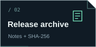

<div align="center">
  
  <p>A native Windows toolkit for performance overlays, frame pacing, borderless play, and audio control.</p>
  <a href="https://github.com/NeTriXoN-BoT/Framoryx/releases/latest/download/Framoryx-Windows-x64.zip"></a>
  &nbsp;
  <a href="https://github.com/NeTriXoN-BoT/Framoryx/releases"></a>
  &nbsp;
  <a href="docs/LINUX.md"></a>
</div>

## Your game. Your overlay.

Keep an eye on real frame data, make the HUD your own, and get back to playing. Framoryx uses Windows ETW events through PresentMon for its default monitoring mode. In-game hooks are a separate, explicit choice.

| Measure | Customize | Take control |
| --- | --- | --- |
| Live FPS, average FPS, 1% lows and frame times | Glass, Compact and Telemetry Bar layouts | Optional DX11/DX12 frame limiter |
| Rolling frame graph and CSV export | Ten independently selectable readouts | Borderless play with window restoration |
| System CPU and memory readouts | Per-game style, accent, opacity and corner | Windows output volume and optional APO gain |
| Automatic desktop HUD fallback | Automatic sizing and percentage overrides | Tray controls, hotkeys and desktop shortcuts |

## Get started

1. Download the Windows ZIP and extract the whole folder.
2. Open **Framoryx.exe**. Open your game, then choose its window or leave **Auto** selected.
3. Click **Show overlay**. Capture starts automatically.

Open **Overlay Studio** to choose a layout, readouts, size, colors and opacity. The Studio preview labels sample values when a game is not reporting data. **Desktop app size → Auto** fits the app to your screen; percentages give you manual control. **Create shortcut** adds a desktop link to the extracted copy.

Keep the application folder together. No account, installer or background service is required for normal monitoring.

## Compatibility, clearly stated

- **Windows 10/11 x64** is the application target. Optional hooks include x64 DX11/DX12 and x86 DX11 support.
- The default **ETW + desktop overlay** path does not inject a DLL into the game.
- The optional in-game HUD/limiter requires a specific process, allow-list approval and an explicit confirmation. Block rules take priority.
- DX12 drawing uses an observed direct queue. Ambiguous queue configurations keep the limiter available and fall back to the desktop HUD in Auto mode.
- Vulkan, OpenGL and DX9 use the desktop monitoring path. Exclusive fullscreen can cover desktop overlays; the game's own borderless mode often provides the best starting point.
- Extra audio gain requires a separately installed and configured **Equalizer APO**. Normal output-volume control works without it.

**In-game hooks remain experimental.** They can conflict with games, overlays or security tools, and no ban-free guarantee is possible. Microsoft Defender quarantined the optional injection stress-test helper during development. That interrupted run is not counted as a pass, and Framoryx does not bypass security protections. See [compatibility and security notes](docs/COMPATIBILITY.md) before enabling hooks.

## Build and verify

From PowerShell in the repository root:

```powershell
./source/build.ps1
```

The build script downloads a pinned, SHA-256-verified portable LLVM-MinGW toolchain when no compiler path is supplied. It builds the app and its test scenes, then runs deterministic core and isolated audio-configuration checks.

```powershell
# Reuse a toolchain and build directory
./source/build.ps1 -ToolchainBin C:\llvm-mingw\bin -BuildDirectory C:\scratch\framoryx

# Non-injecting ETW/borderless soak
./source/validate.ps1 -ToolchainBin C:\llvm-mingw\bin -SoakSeconds 120

# Explicit local graphics checks against bundled test scenes only
./source/validate.ps1 -ToolchainBin C:\llvm-mingw\bin -IncludeGraphicsTests
```

See [building and testing](docs/BUILDING.md) for details. The Linux CI job checks the portable statistics, rules, scaling and motion core; it does **not** build a Linux desktop application.

## Project status

Version **0.2.0** adds Overlay Studio, three HUD layouts, per-game presentation profiles, sharp font resizing, desktop scale controls, a refresh-aware animation clock, DX12 HUD support, compatibility inspection and tray access.

Local test scenes establish behavior on the development configuration; they are not a commercial-game compatibility certification. [Release notes](docs/releases/v0.2.0.md) describe the validation and current limits. A native Linux application is [planned separately](docs/LINUX.md).

## Contribute

Please use the [bug-report template](.github/ISSUE_TEMPLATE/bug.yml) for reproducible issues and the [game-compatibility template](.github/ISSUE_TEMPLATE/game.yml) for renderer/window-mode reports. Include only relevant, sanitized diagnostics.

Original project code is available under the [MIT license](LICENSE). Third-party components retain their own licenses; see [notices](THIRD-PARTY-NOTICES.txt).
